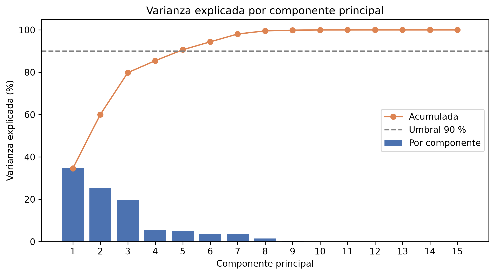
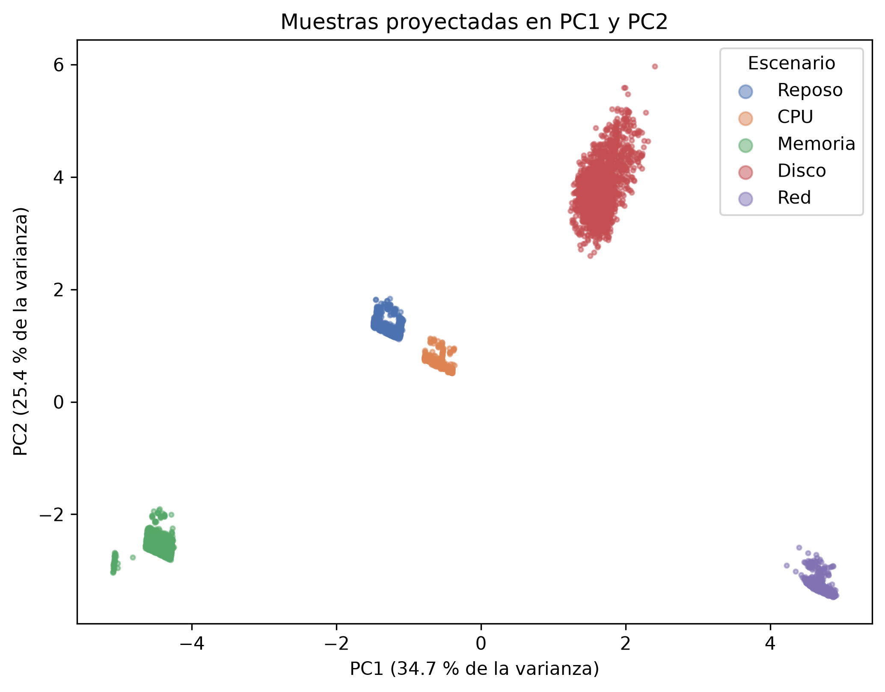

# pca-telemetry-linux

Dimensionality reduction of Linux server telemetry with PCA: sar/sysstat data under controlled stress-ng workloads, evaluating how much system behavior is preserved with fewer metrics.

This repository contains the data, code and proof of concept of the research
project *Compresión y selección de variables de telemetría en servidores Linux
utilizando Análisis de Componentes Principales (PCA)*, developed for the course
Metodología de la Investigación at Universidad Distrital Francisco José de
Caldas.

## Research question

> Is it possible to reduce the monitoring variables of a Linux system using
> PCA while preserving most of the information about its behavior?

**Hypothesis:** k ≤ 5 principal components retain at least 90 % of the
variance of the `sar` metrics.

## Main results

Dataset: 5 load scenarios × 30 min at 1 sample/s on a Debian 13 KVM virtual
machine (2 vCPU, 7.8 GiB RAM) hosted on a local Proxmox server.

| Result | Value |
| :----- | :---- |
| Metrics after preprocessing (P) | 27 |
| Components for 80 / 90 / 95 % of the variance | 4 / **5** / 7 |
| Cumulative variance with k = 5 | **90.6 %** (18.5 % of the dimensions) |
| Reconstruction error, same dimension (11): PCA vs. correlation filter | 0.73 % vs. 1.88 % |
| Scenario classification accuracy: 27 metrics vs. 5 PCs | 100 % vs. 100 % |
| K-Means Silhouette: 27 metrics vs. 5 PCs (ARI = 1 in both) | 0.78 vs. 0.86 |

The hypothesis holds. Each component maps to a subsystem of the server:
PC1 network and kernel work, PC2 disk, PC3 memory and page cache, PC4 user
CPU, PC5 disk writes versus reads.

<p align="center">
  
  
</p>

The limitations (synthetic scenarios that saturate one resource each, page
cache drift across the run, a single virtual server) are discussed at the end
of the notebook.

## Repository structure

```
pca-telemetry-linux/
├── collection/         # Bash scripts that collect the data (sar + stress-ng)
│   ├── collect.sh
│   ├── export_csv.sh
│   └── scenarios.md    # load scenarios, parameters and output format
├── data/
│   ├── raw/            # CSV exported from sar, one folder per scenario
│   └── processed/      # merged dataset (telemetry.csv)
├── src/pca_telemetry/  # Python package used by the notebook
│   ├── loading.py      # read and merge the sar CSV files
│   ├── preprocessing.py  # trim transients, clean, drop constants, z-score
│   ├── analysis.py     # PCA, reconstruction, loadings and baselines
│   └── plots.py        # figures (Spanish labels by default, lang="en")
├── notebooks/
│   └── 01_proof_of_concept_pca.ipynb
├── results/
│   ├── figures/        # PNG (300 dpi) and PDF
│   └── tables/         # CSV
├── tests/              # pytest suite with synthetic data
├── app/                # planned monitoring application
├── pyproject.toml
└── requirements.txt
```

## Requirements

- **Data collection** (Linux server): `bash`, `sysstat` and `stress-ng`.
  On Debian/Ubuntu: `sudo apt install sysstat stress-ng`.
- **Analysis**: Python ≥ 3.10 with the packages in `requirements.txt`
  (numpy, pandas, scikit-learn, matplotlib, JupyterLab, pytest).

## Usage

### 1. Collect the data (on the server)

```bash
# Quick test: 60 s per scenario
./collection/collect.sh -d 60 -p 10 -o /tmp/test_raw
./collection/export_csv.sh -i /tmp/test_raw

# Full run, about 2 h 34 min (run it inside tmux or screen)
./collection/collect.sh && ./collection/export_csv.sh
```

The loads affect any service running on the server, so run them when it is
not serving users. On a Proxmox VM, disable memory ballooning so the
`memory` scenario is not distorted. See
[`collection/scenarios.md`](collection/scenarios.md) for the scenarios,
options and output format.

The dataset used in the project is already in `data/raw/`, so this step is
only needed to reproduce the experiment on another server.

### 2. Install the analysis environment

```bash
python -m venv .venv
source .venv/bin/activate
pip install -r requirements.txt
pip install -e .
```

`pip install -e .` installs the `pca_telemetry` package from `src/`, which the
notebook imports.

### 3. Run the notebook

```bash
source .venv/bin/activate
jupyter lab
```

Open `notebooks/01_proof_of_concept_pca.ipynb` and run
**Run → Restart Kernel and Run All Cells**. It regenerates every figure in
`results/figures/` and every table in `results/tables/`. The notebook text is
in Spanish; the code is in English.

The package can also be used directly:

```python
from pca_telemetry import analysis, loading, preprocessing

data = loading.load_dataset("data/raw")
X, Xz, y, report = preprocessing.prepare(data)
pca = analysis.fit_pca(Xz)
print(analysis.components_table(pca))
```

### 4. Run the tests

```bash
pytest
```

## Method

1. **Collection:** `sar` records CPU, memory, disk, task and network metrics
   every second while `stress-ng` applies five loads: `idle`, `cpu`,
   `memory`, `disk` and `network`.
2. **Preprocessing:** join the metric groups by timestamp, trim 5 s of
   transient at each end of every scenario, remove missing and duplicated
   rows, drop constant metrics and standardize with z-score.
3. **PCA:** eigendecomposition of the covariance matrix
   Σ = XzᵀXz / (N − 1) = WΛWᵀ, projection Z = Xz W_k and reconstruction
   X̂ = Z W_kᵀ, choosing k by cumulative explained variance.
4. **Evaluation:** relative reconstruction error (Frobenius norm),
   interpretation of the loadings, and three baselines: a correlation filter
   (|r| > 0.9), a logistic regression scenario classifier validated with
   contiguous time blocks, and K-Means clustering with and without PCA
   (Silhouette and ARI).

## Author

Sean Sebastian Bolivar Calderon, Universidad Distrital Francisco José de Caldas.

## License

This project is licensed under the GNU General Public License v3.0. See
[`LICENSE`](LICENSE).
